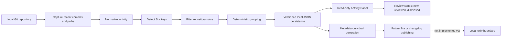

# AnyChange

[](https://opensource.org/licenses/MIT)
[](https://nodejs.org/)
[](https://code.visualstudio.com/)

AnyChange is a local-first Visual Studio Code extension for turning repository activity into
reviewable, intentional changes. It helps developers understand what changed, connect activity
to work items, and prepare local metadata without requiring a hosted service or sending source
data to a remote provider.

## How AnyChange works

The flow below shows the current local-first path from repository activity to reviewable
metadata. Jira or changelog publishing is intentionally shown as future work, not as an
available capability.



The Activity Panel reads persisted local values and supports manual refresh; it does not edit
review states or publish data to Jira, changelog systems, or other hosted services.

## The problem AnyChange solves

When visiting a furniture store, it is engaging to explore complete room settings because
seeing tables, chairs, and lighting together makes their aesthetic and practical possibilities
easier to understand. Software work benefits from the same kind of context: a list of isolated
commits or tickets rarely shows how individual changes fit together as a coherent piece of work.

AnyChange turns local repository activity into a reviewable view of that context:

- **Developers** can see which commits and files belong together before preparing a change.
- **Product managers** can connect work-item keys to the implementation activity behind a feature.
- **Software engineers** can review authors, subjects, paths, timestamps, and local review states
  in one place.
- **QA engineers** can use the captured paths and grouped activity to identify what deserves
  validation.
- **Technical leads and reviewers** can distinguish new, reviewed, and dismissed activity without
  relying on a hosted service.

The goal is not to replace source control or project management tools. It is to make the shape and
context of local changes easier to explore before deciding what should become a formal draft or
review.

## What the extension does

- Captures recent activity from the local Git repository through the `git` executable.
- Normalizes commit metadata and changed paths into deterministic activity records.
- Detects Jira-style ticket keys such as `PROJ-123` in commit subjects and paths.
- Filters common generated, dependency, and repository-noise paths while preserving source changes.
- Groups activity by ticket key and keeps untagged activity in an explicit ungrouped group.
- Stores activity locally in a versioned JSON file under the VS Code extension storage directory.
- Deduplicates repeated captures by repository and commit identity.
- Uses atomic writes and backup recovery to protect local history.
- Tracks local review states: `new`, `reviewed`, and `dismissed`.
- Displays persisted activity in the read-only `AnyChange: Open Activity Panel` view.
- Produces metadata-only draft information with no Jira publishing or hosted-service dependency.

### Activity panel

Run **AnyChange: Open Activity Panel** from the Command Palette to inspect all locally
persisted activity. Each entry displays:

- Repository and commit identity.
- Branch availability, author, subject, and timestamps.
- Changed paths and detected Jira keys.
- Current local review state.

The panel loads fresh data whenever it opens and provides a **Refresh** button for subsequent
updates. It is intentionally read-only and local-only: it does not edit review states, publish
to Jira, call hosted services, or make network requests. Branch information is shown as
unavailable until it is captured in the persisted activity schema.

## Implementation plan

### Completed

- ~~Create the TypeScript-based VS Code extension scaffold.~~
- ~~Add the `AnyChange: Open Workspace` command and local workspace initialization.~~
- ~~Capture and normalize local Git activity.~~
- ~~Detect Jira-style ticket keys and filter repository noise.~~
- ~~Group activity deterministically, including an ungrouped bucket.~~
- ~~Persist activity locally with schema versioning, atomic replacement, backup recovery, and deduplication.~~
- ~~Add the initial local review-state model.~~
- ~~Add a metadata-only draft-provider boundary without remote publishing.~~
- ~~Add a read-only activity panel with safe local rendering and refresh support.~~

### Next

- [ ] Add review-focused filtering and navigation to the activity panel.
- [ ] Allow users to filter and sort persisted activity by ticket, repository path, date, and review state.
- [ ] Add explicit commands for marking activity as reviewed or dismissed.
- [ ] Improve repository identity handling for multi-root workspaces.
- [ ] Add configurable ticket-key patterns and noise-filter rules.
- [ ] Add draft editing and export while preserving the local-only default.
- [ ] Add optional provider integrations only after the local review workflow is stable.

## Development

Requirements: Node.js 20 or newer and Visual Studio Code 1.85 or newer.

```sh
npm install
npm run check
npm test
npm run build
```

The compiled extension is written to `dist/`.

## Try it locally in VS Code

You can run the extension directly from the repository without installing it from the
VS Code Marketplace:

1. Clone the repository and open its folder in VS Code.
2. Install dependencies and build the extension:

   ```sh
   npm install
   npm run build
   ```

3. Open the **Run and Debug** view and select **Run Extension** if a launch configuration
   is available.
4. Press **F5** to launch a new Extension Development Host window.
5. In the Extension Development Host, open a Git repository and run **AnyChange: Open Workspace**
   or **AnyChange: Capture Local Activity** from the Command Palette. Then run
   **AnyChange: Open Activity Panel** to inspect the persisted activity.

The extension runs from the local source and compiled output in `dist/`; no Marketplace
installation is required. After source changes, stop and restart the Extension Development
Host to load the updated build.

## License

AnyChange is licensed under the [MIT License](https://opensource.org/license/mit/).
